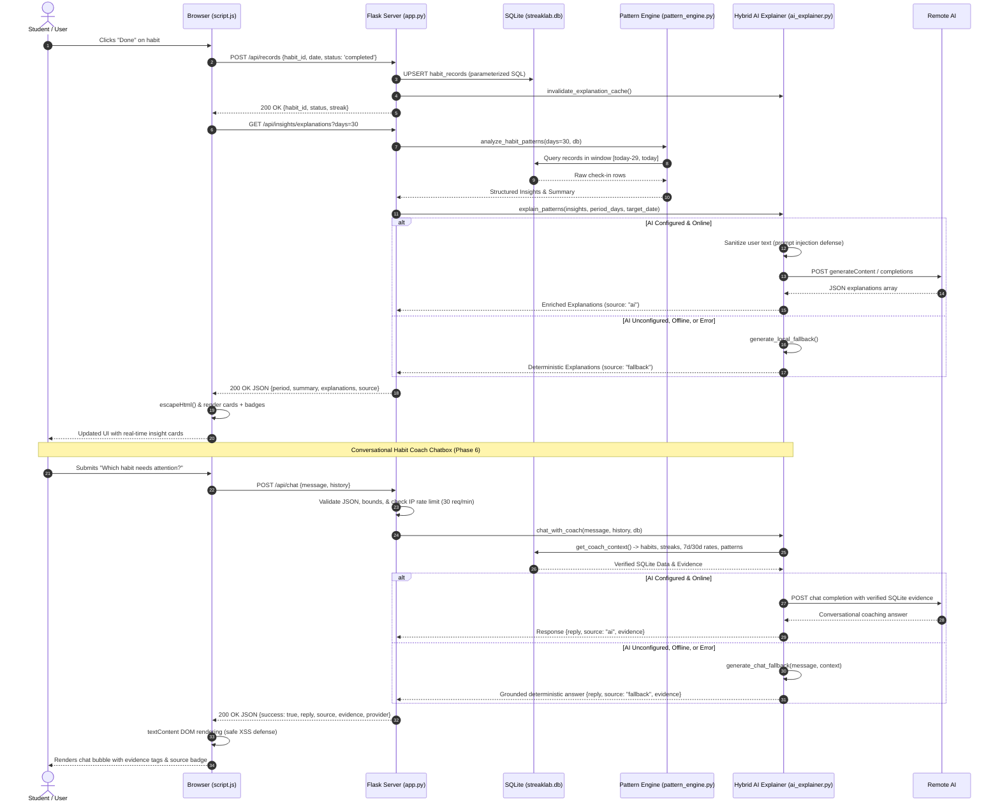

# StreakLab Architecture & System Flow

StreakLab is designed around a **hybrid, decoupled architecture** that separates statistical truth from language explanations. This document explains the system components, dataflow, security boundaries, and error recovery strategies.

---

## 1. High-Level System Architecture

```text
┌───────────────────────────────────────────────────────────────────┐
│                    Client Browser (Frontend)                      │
│   • HTML5 / Bootstrap 5.3 UI / Custom CSS Tokens                 │
│   • Vanilla ES6 JavaScript (Fetch API + DOM Manipulation)         │
│   • Chart.js Visualizations (Weekly & Time-of-Day Distribution)   │
└───────────────────────────────┬───────────────────────────────────┘
                                │ JSON REST API (HTTP)
                                ▼
┌───────────────────────────────────────────────────────────────────┐
│                    Flask Backend (app.py)                         │
│   • RESTful Endpoints: /api/habits, /api/records, /api/insights   │
│   • Request Validation & Sanitization                             │
│   • Connection Lifecycle Management (g.db)                        │
└───────────────┬───────────────────────────────────┬───────────────┘
                │                                   │
                ▼                                   ▼
┌───────────────────────────────┐   ┌───────────────────────────────┐
│       SQLite Database         │   │     Statistical Engine        │
│   (instance/streaklab.db)     │   │     (pattern_engine.py)       │
│ • habits table                │   │ • Source of Truth for stats   │
│ • habit_records table         │   │ • Streaks, rates, drop-offs   │
│ • Foreign key & index guards  │   │ • Deterministic calculations  │
└───────────────────────────────┘   └───────────────┬───────────────┘
                                                    │
                                                    │ Structured Evidence Payload
                                                    ▼
                                    ┌───────────────────────────────┐
                                    │    Hybrid AI Explainer        │
                                    │     (ai_explainer.py)         │
                                    │ • Optional Gemini / OpenAI    │
                                    │ • Deterministic Local Fallback│
                                    │ • In-Memory TTL Cache         │
                                    └───────────────────────────────┘
```

---

## 2. Core Components

### Component 1: Frontend Client
* **Files**: `templates/index.html`, `static/style.css`, `static/script.js`
* **Responsibilities**:
  * Renders today's habit check-list, summary KPI metric cards, and responsive Chart.js graphs.
  * Communicates asynchronously via `fetch()` with Flask backend endpoints.
  * Dispatches dynamic status changes (`completed`, `missed`, `skipped`, `pending`).
  * Enforces client-side XSS safety via `escapeHtml()` on all user-supplied and AI-generated strings before DOM insertion.
  * Gracefully handles server errors with retry buttons and non-blocking toast notifications.

### Component 2: Flask Application Service
* **File**: `app.py`
* **Responsibilities**:
  * Serves the single-page application dashboard and manages database connections per request context (`g.db`).
  * Exposes validated RESTful routes with strict status codes (`200`, `201`, `400`, `404`, `500`).
  * Enforces SQLite foreign key constraints (`PRAGMA foreign_keys = ON`).
  * Implements UPSERT logic for daily habit records (`ON CONFLICT(habit_id, record_date) DO UPDATE`).
  * Automatically invalidates cached pattern explanations on any habit or record mutation.

### Component 3: Database Persistence Layer
* **File**: `instance/streaklab.db` (SQLite)
* **Schema**:
  * `habits`: `id` (PK), `name`, `description`, `category`, `time_of_day`, `target_time`, `target_frequency`, `created_at`, `active`.
  * `habit_records`: `id` (PK), `habit_id` (FK -> habits.id ON DELETE CASCADE), `record_date`, `status` (`completed`, `missed`, `skipped`), `created_at`, `updated_at`.
  * `indices`: `idx_records_habit_date` on `(habit_id, record_date)`, `idx_records_date` on `(record_date)`.

### Component 4: Rule-Based Statistical Pattern Engine
* **File**: `pattern_engine.py`
* **Responsibilities**:
  * Serves as the **sole authority for numerical metrics and statistical patterns**.
  * Calculates best streaks, consecutive misses, day-of-week drop-offs, and time-of-day variations.
  * Strictly excludes future records and guards against division-by-zero.
  * Assigns qualitative confidence levels (`low`, `medium`, `high`) based on sample sizes.

### Component 5: Hybrid AI Explainer & Local Fallback
* **File**: `ai_explainer.py`
* **Responsibilities**:
  * Receives structured evidence items from `pattern_engine.py`.
  * Translates patterns into clear, student-friendly coaching explanations and recommendations.
  * Grounded exclusively in supplied evidence; **never invents statistics or streaks**.
  * Employs standard library `urllib.request` with timeouts (default 6s) to contact Gemini or OpenAI.
  * Automatically switches to deterministic local fallback on network errors, timeouts, or missing API keys.
  * Implements an in-memory TTL cache (5 minutes) keyed by an evidence fingerprint.

### Component 6: Real AI Habit Coach Chatbox (Phase 6)
* **Files**: `templates/index.html` (modal & launcher), `static/style.css` (chat drawer styling), `static/script.js` (DOM-safe chat rendering & session management), `app.py` (`POST /api/chat`), `ai_explainer.py` (`chat_with_coach`)
* **Responsibilities**:
  * Provides an interactive floating chat assistant on the dashboard.
  * Accepts natural-language questions and bounded conversation history (`POST /api/chat`).
  * Enforces sliding-window in-memory IP rate limiting (30 requests/minute) to prevent spam and abuse.
  * Dynamically extracts the user's active habits, today's completion status, 7-day/30-day rates, and detected pattern evidence from SQLite.
  * Passes verified context to Google Gemini or OpenAI with strict system instructions prohibiting statistical hallucination.
  * Uses deterministic rule-based local coach fallback when offline or unconfigured.
  * Renders responses strictly using `textContent` and safe DOM text nodes, guaranteeing complete XSS immunity.

---

## 3. Data Flow



---

## 4. Security & Safety Boundaries

1. **Prompt Injection Mitigation**: Habit names, categories, descriptions, and user queries are treated strictly as passive data tokens. Injected instructions (e.g. `SYSTEM OVERRIDE`) are completely ignored by the system prompts.
2. **Abuse Protection & Rate Limiting**: The `/api/chat` endpoint enforces a sliding-window in-memory IP rate limiter (30 requests/60s). Excess requests receive `429 Too Many Requests`.
3. **Zero External Calls on Boot/Test**: Application startup and test runs never invoke remote APIs. Tests use 100% mocked providers on isolated temporary databases.
4. **No Leakage of Secrets**: API keys and raw error traces are strictly kept on the server and are never returned in JSON error responses or client payloads.
5. **Non-Destructive Persistence**: Deactivating a habit sets `active = 0`, keeping historical records intact for analytics while hiding it from active daily tracking.
6. **No Dangerous Evaluation**: The frontend uses `escapeHtml()` and DOM property bindings (`textContent`), avoiding `eval()` or unescaped HTML injection. User and AI chat bubbles are constructed purely with safe DOM text nodes.
